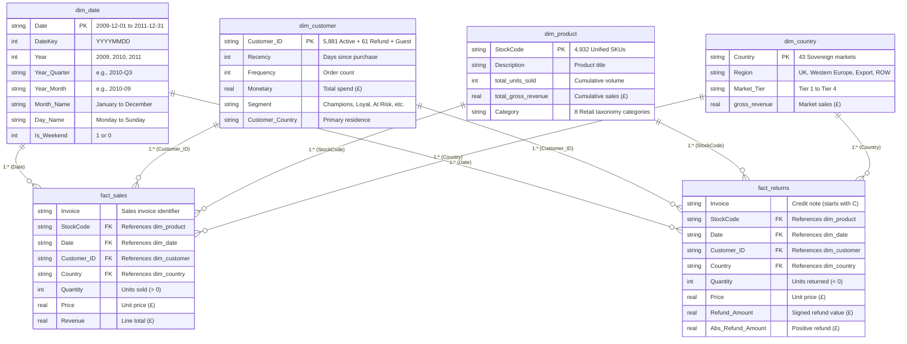

# E-Commerce Sales Analytics & Business Intelligence System
### End-to-End Commercial Data Analytics, Customer Intelligence (RFM & Cohorts), SQL Data Warehousing & Power BI Semantic Modeling

**Dataset:** UCI Online Retail II (UK Registered Non-Store Online Retailer)  
**Analysis Period:** 1 December 2009 – 9 December 2011 (24.3 Months)  
**Tools:** Python (Pandas, NumPy, Matplotlib, Seaborn), SQLite, SQL, Power BI (DAX, Star Schema Modeling)  
**Primary Deliverables:** 7 Executed Notebooks, SQLite Analytics Database, Production SQL Scripts, Power BI Data Warehouse, Analytical Reports  

---

## 1. Project Overview

This project delivers an enterprise-grade, end-to-end data analytics and business intelligence solution for a UK-based online retail merchant specializing in unique giftware and wholesale merchandise. 

Covering over **1.06 million raw transaction records** spanning two operating cycles (December 2009 through December 2011), the project moves across the complete analytical lifecycle:
1. **Raw Data Audit & Quality Profiling:** Comprehensive auditing of missing values, duplicate rows, credit notes, and internal bookkeeping entries without data destruction.
2. **Context-Aware Data Cleaning & Pipeline Normalization:** Partitioning transactions into valid commercial sales, cancellations/refunds, inventory adjustments, and bad debt write-offs with 100% mathematical reconciliation back to raw source files.
3. **Exploratory Data Analysis (EDA):** Quantifying commercial KPIs, temporal trends, hour-of-day/day-of-week demand patterns, product Pareto distributions, and market concentration.
4. **Customer Behavioral Analytics:** Quantile-based RFM segmentation, customer lifetime value profiling, and monthly cohort retention analysis.
5. **Relational Data Warehousing (SQL):** SQLite schema design with performance indexes, CTEs, window functions (`ROW_NUMBER`, `DENSE_RANK`, `LAG`, `LEAD`, cumulative sums), and production views.
6. **Semantic Data Modeling (Power BI):** A Kimball-compliant **Star Schema** with shared conforming dimensions, zero-orphan referential integrity, and 17 production DAX measures.
7. **Executive Reporting:** Strategic insights, commercial implications, and prioritized business recommendations.

---

## 2. Business Problem

An e-commerce business operating on high-volume catalog transactions often struggles with:
- **Revenue Obscurity:** Misclassifying order cancellations, carrier fees, and warehouse inventory damage as normal sales, leading to distorted revenue and customer metrics.
- **Customer Churn & Concentration Risk:** Inability to identify which accounts drive the majority of cash flow, leading to misallocated marketing budgets and unmonitored VIP client attrition.
- **Post-Acquisition Drop-off:** High initial customer acquisition volume that fails to convert into recurring wholesale order streams.
- **Seasonal Working Capital Strain:** Multi-month demand surges in Q4 (Christmas trade) that strain supply chain logistics and cash flow if not forecasted accurately.
- **Product Long-Tail Inefficiency:** Carrying thousands of non-performing SKUs that incur warehouse carrying costs while failing to generate meaningful commercial margin.

This project resolves these challenges by building an audited single source of truth and translating raw transactional data into actionable commercial strategies.

---

## 3. Project Objectives

- **Audit & Clean:** Audit 1,067,371 raw transaction lines, isolate non-sales transactions (cancellations, debt adjustments, warehouse checks), and produce an audited commercial sales dataset.
- **Benchmark KPIs:** Establish precise baseline metrics for gross revenue, orders, active customers, AOV, units sold, and return rates.
- **Map Market & Catalog Concentration:** Quantify domestic vs. export market share and verify catalog revenue concentration against the Pareto Principle.
- **Segment Customer Base (RFM):** Segment registered buyers into actionable behavioral cohorts (Champions, Loyal Customers, At Risk, Cannot Lose Them, Hibernating) using recency, frequency, and monetary metrics.
- **Analyze Retention & Churn:** Build a monthly customer cohort retention matrix spanning 24 months to quantify lifecycle longevity and churn cliffs.
- **Implement Relational SQL Warehouse:** Design and populate an analytical database (`ecommerce_analytics.db`) with indexing, views, and advanced window queries.
- **Engineer Power BI Semantic Model:** Design a Kimball Star Schema with shared conforming dimensions (`dim_date`, `dim_customer`, `dim_product`, `dim_country`) and DAX business measures.
- **Formulate Strategic Recommendations:** Provide data-backed recommendations with implementation roadmaps to maximize client retention and inventory turnover.

---

## 4. Dataset Information & Source

The dataset used is the **Online Retail II** dataset provided by the **UCI Machine Learning Repository**, containing actual transactions for a UK-based registered non-store online retailer between 01/12/2009 and 09/12/2011.

- **Primary Source File:** `data/raw/online_retail_II.xlsx` (Excel workbook containing two sheets: `Year 2009-2010` and `Year 2010-2011`).
- **Total Raw Records:** 1,067,371 rows across 8 features:
  - `Invoice`: 6-digit transaction number (prefixed with 'C' for cancellations).
  - `StockCode`: 5-digit product SKU identifier or administrative code.
  - `Description`: Nominal product/service title.
  - `Quantity`: Number of units per transaction line (negative values represent returns or adjustments).
  - `InvoiceDate`: Timestamp of transaction (`YYYY-MM-DD HH:MM:SS`).
  - `Price`: Unit price in Sterling (£).
  - `Customer ID`: 5-digit unique customer account identifier.
  - `Country`: Customer's country of registration/residence.

---

## 5. Technology Stack

| Layer | Tools & Libraries | Purpose |
| :--- | :--- | :--- |
| **Data Manipulation & Pipeline** | Python 3.12, Pandas 3.1, NumPy 2.5 | Ingestion, data cleaning, type coercion, validation, transformation |
| **Statistical Analysis & Visualization** | Matplotlib, Seaborn | Exploratory data analysis, heatmaps, distribution plots, Pareto charts |
| **Customer Intelligence** | Python (Pandas, SciPy) | Quantile-based RFM scoring, cohort matrix construction, retention modeling |
| **Relational Database & Warehousing** | SQLite 3.43, SQL (DDL, DML, DQL) | Table schema design, B-tree indexes, CTEs, Window functions, analytical views |
| **Semantic Modeling & BI** | Power BI Desktop, DAX, Power Query | Star Schema modeling, 1-to-many single-direction filtering, DAX measures |
| **Version Control & Documentation** | Git, Markdown | Structured technical documentation, reproducibility, reporting |

---

## 6. Project Folder Structure

```
Ecommerce-Sales-Analytics/
├── README.md                                  # Enterprise Portfolio Project Documentation
├── data/
│   ├── raw/
│   │   └── online_retail_II.xlsx              # Original immutable raw Excel dataset (UCI)
│   └── processed/
│       ├── clean_regular_sales.csv            # Clean commercial sales transactions (1,007,983 rows)
│       ├── returns_and_cancellations.csv      # Customer cancellations & credit notes (19,104 rows)
│       ├── inventory_adjustments.csv          # Internal warehouse adjustments (5,944 rows)
│       ├── accounting_adjustments.csv         # Bad debt adjustments (5 rows)
│       ├── promotional_orders.csv             # Customer promotional zero-price gifts (71 rows)
│       ├── ecommerce_analytics.db             # Relational SQLite warehouse (tables, indexes, views)
│       └── powerbi/                           # Exported Star Schema tables for Power BI ingestion
│           ├── dim_date.csv                   # Continuous calendar dimension (761 days)
│           ├── dim_customer.csv               # Master customer dimension (5,943 entities)
│           ├── dim_product.csv                # Unified catalog dimension (4,932 SKUs)
│           ├── dim_country.csv                # Geographic dimension (43 countries)
│           ├── fact_sales.csv                 # Optimized commercial sales fact table (1.01M rows)
│           └── fact_returns.csv               # Optimized customer return fact table (19.1k rows)
├── notebooks/
│   ├── 01_data_exploration.ipynb              # Preliminary exploration on Year 2009-2010
│   ├── 02_complete_dataset_audit.ipynb        # Exhaustive 1.067M row data-quality audit
│   ├── 03_data_cleaning.ipynb                 # Context-aware segmentation & feature engineering
│   ├── 04_exploratory_data_analysis.ipynb     # Commercial KPIs, Pareto, seasonality & geography
│   ├── 05_customer_segmentation_and_cohort_analysis.ipynb # RFM segmentation & cohort retention
│   ├── 06_sql_business_analysis.ipynb         # SQLite warehouse, CTEs, window functions & views
│   └── 07_powerbi_data_preparation.ipynb      # Star Schema engineering & referential integrity audit
├── sql/
│   ├── 01_schema_and_views.sql                # Production DDL, performance indexes & 5 views
│   └── 02_analytical_queries.sql              # Catalog of basic, intermediate & window queries
├── reports/
│   ├── final_business_report.md               # Executive business insights & strategic roadmap
│   ├── customer_analysis/                     # RFM and cohort retention data exports & plots
│   ├── eda_charts/                            # High-resolution charts from exploratory analysis
│   └── sql_analysis/                          # SQL query results & metric reconciliation report
└── docs/
    ├── powerbi_star_schema.md                 # Star Schema ERD, cardinalities & relationship specs
    └── powerbi_dax_measures.md                # Complete catalog of 17 production DAX formulas
```

---

## 7. Data Cleaning & Segmentation Methodology

The raw dataset contains 1,067,371 rows across both years. Rather than blindly dropping anomalies, a **context-aware segmentation approach** was implemented in [`notebooks/03_data_cleaning.ipynb`](notebooks/03_data_cleaning.ipynb):

```
                        1,067,371 Raw Transactions
                                    │
               Remove 34,335 Exact Duplicates (3.22%)
                                    │
                       1,033,036 Deduplicated Rows
                                    │
     ┌──────────────────────────────┼──────────────────────────────┬──────────────────────────────┐
     ▼                              ▼                              ▼                              ▼
Commercial Sales           Credit-Note Returns           Inventory Adjustments         Accounting Debt
1,007,983 Rows             19,104 Rows                   5,944 Rows                    5 Rows
(clean_regular_sales.csv)  (returns_and_cancellations)   (inventory_adjustments.csv)   (accounting_adjustments)
• Quantity > 0             • Invoice starts with 'C'     • Price == 0.0                • Price < 0.0
• Price > 0                • Positive & negative         • Unassigned Customer ID      • "Adjust bad debt"
• Valid regular sales      • Commercial cancellations    • Warehouse write-offs        • Balance adjustments
```

### Mathematical Reconciliation Matrix

| Segment / Category | Row Count | % of Raw Data | Business Meaning | Destination Dataset |
| :--- | :--- | :--- | :--- | :--- |
| **Raw Input Records** | **1,067,371** | 100.00% | Combined Year 2009-2010 and 2010-2011 sheets | `online_retail_II.xlsx` |
| **Exact Duplicate Rows** | **34,335** | 3.22% | Exact 8-column duplicate records removed | — |
| **Deduplicated Working Set**| **1,033,036** | 96.78% | Baseline working universe | — |
| **Valid Commercial Sales** | **1,007,983** | 94.44% | Valid positive sales transactions | `clean_regular_sales.csv` |
| **Cancelled Orders / Returns**| **19,104** | 1.79% | Invoices starting with 'C' (credit notes) | `returns_and_cancellations.csv` |
| **Internal Inventory Adjustments**| **5,944** | 0.56% | Zero-price internal warehouse write-offs | `inventory_adjustments.csv` |
| **Accounting Debt Adjustments**| **5** | 0.0005% | Negative prices titled "Adjust bad debt" | `accounting_adjustments.csv` |
| **Promotional Gifts (Retained)**| *(71)* | *(0.007%)* | Zero-price gifts to registered customers | Retained in `clean_regular_sales` |

$$\text{Reconciled Sum: } 1,007,983 + 19,104 + 5,944 + 5 + 34,335 = \mathbf{1,067,371 \text{ rows (100.00\% accounted for)}}.$$

---

## 8. Exploratory Data Analysis & Key Findings

Comprehensive EDA was executed in [`notebooks/04_exploratory_data_analysis.ipynb`](notebooks/04_exploratory_data_analysis.ipynb), yielding the following enterprise baseline benchmarks:

### 8.1 Commercial Baseline KPIs

| Metric | Benchmark Value | Operational Definition |
| :--- | :--- | :--- |
| **Gross Commercial Sales** | **£20,476,260.45** | Line-item gross sales ($\sum Quantity \times Price$) across valid regular orders |
| **Gross Returns & Refunds** | **-£1,462,050.61** | Total credit notes issued for customer cancellations |
| **Net Commercial Revenue** | **£19,014,209.84** | Gross sales minus customer refunds |
| **Commercial Return Rate** | **7.14%** | Value of refunds divided by gross regular commercial sales |
| **Total Valid Orders** | **40,083** | Distinct commercial sales invoices |
| **Average Order Value (AOV)** | **£510.85** | Gross sales revenue divided by total commercial orders |
| **Physical Units Dispatched** | **11,219,901 units** | Cumulative positive item quantities shipped |
| **Unique Product Catalog** | **4,917 SKUs** | Active transacted commercial catalog items |
| **Registered Customer Accounts**| **5,881** | Distinct identified customer accounts making valid purchases |
| **Avg Revenue Per Customer** | **£2,954.40** | Total registered revenue divided by registered accounts |
| **Guest Checkout Revenue** | **£3,101,456.18** | Revenue from transactions without a Customer ID (15.15% share) |

### 8.2 Operational & Temporal Patterns
- **Midweek Concentration:** Peak ordering occurs on **Thursday** (£4.20M; 20.49%) and **Tuesday** (£4.08M; 19.92%). Monday through Friday accounts for **91.17% of total revenue**.
- **Weekend Inactivity:** Saturday is effectively closed, generating only **30 orders and £9,803.05 across two full years** (0.05% of sales).
- **Core Purchasing Window:** **74.39% of sales occur between 10:00 AM and 3:00 PM**, peaking at 12:00 PM (£2.85M; 13.92%), reflecting typical B2B office procurement hours.
- **Intense Q4 Holiday Seasonality:** Monthly revenue surges from summer baselines (~£650k–£750k) to major peaks in November 2010 (£1.46M; +26.0% MoM) and November 2011 (£1.50M; +30.6% MoM).

### 8.3 Pareto Product Concentration (80/20 Rule)
- **Top 1% of SKUs (50 items):** Generate **21.77%** of revenue (£4.46M).
- **Top 5% of SKUs (246 items):** Generate **48.33%** of revenue (£9.90M).
- **Top 10% of SKUs (492 items):** Generate **63.87%** of revenue (£13.08M).
- **Top 20% of SKUs (984 items):** Generate **79.47%** of revenue (£16.27M) — **empirically validating the 80/20 Pareto rule**.
- **Bottom 50% of SKUs (2,458 items):** Account for merely **5.14%** of total revenue.

---

## 9. Customer Segmentation (RFM) & Cohort Retention Analysis

Executed in [`notebooks/05_customer_segmentation_and_cohort_analysis.ipynb`](notebooks/05_customer_segmentation_and_cohort_analysis.ipynb), customer behavioral analysis was performed across all 5,881 registered accounts using the day after the last transaction date (`2011-12-10`) as the reference snapshot date.

### 9.1 RFM Segment Breakdown

| RFM Segment | Customer Count | Customer Share (%) | Total Revenue (£) | Revenue Share (%) | Total Orders | Avg Spend / Cust (£) | Segment AOV (£) | Avg Recency (Days) | Avg Frequency (Orders) |
| :--- | :--- | :--- | :--- | :--- | :--- | :--- | :--- | :--- | :--- |
| **Champions** | 1,291 | 21.95% | £11,836,647.74 | **68.13%** | 22,128 | £9,168.59 | £534.92 | 19.3 | 17.1 |
| **Loyal Customers** | 1,147 | 19.50% | £2,592,612.65 | **14.92%** | 6,844 | £2,260.34 | £378.82 | 73.1 | 6.0 |
| **Cannot Lose Them** | 224 | 3.81% | £984,286.42 | **5.67%** | 2,006 | £4,394.14 | £490.67 | 341.5 | 9.0 |
| **At Risk** | 841 | 14.30% | £933,225.15 | **5.37%** | 2,445 | £1,109.66 | £381.69 | 390.4 | 2.9 |
| **Potential Loyalists** | 415 | 7.06% | £391,761.03 | **2.25%** | 865 | £944.00 | £452.90 | 26.1 | 2.1 |
| **Hibernating** | 1,280 | 21.77% | £322,732.22 | **1.86%** | 1,516 | £252.13 | £212.88 | 467.4 | 1.2 |
| **Others (Promising/Attention)**| 516 | 8.77% | £258,090.88 | **1.49%** | 1,004 | £500.18 | £257.06 | 105.6 | 1.9 |
| **New Customers** | 167 | 2.84% | £55,448.17 | **0.32%** | 167 | £332.02 | £332.02 | 28.8 | 1.0 |
| **Total Registered** | **5,881** | **100.00%** | **£17,374,804.27** | **100.00%** | **36,975** | **£2,954.40** | **£469.91** | — | — |

### 9.2 Key Customer Insights
- **The 68% Champion Anchor:** 1,291 *Champions* generate **68.13% (£11.84M)** of all registered revenue with an average spend of £9,168.59.
- **£1.92M in Immediate At-Risk Revenue:** The *Cannot Lose Them* (224 accounts; £984.3k) and *At Risk* (841 accounts; £933.2k) cohorts represent **1,065 high-value buyers** who spent £1.92M historically but have been inactive for over 340 to 390 days.
- **The Acquisition Churn Cliff:** **75% to 84% of newly acquired customers fail to place a second order in Month 1**, leaving 1,280 accounts (21.77%) dormant in the *Hibernating* segment.
- **Q4 Re-Engagement Spikes:** Retention surges significantly in Month 11–12 and Month 23–24 across older cohorts as dormant accounts return for holiday procurement.

---

## 10. Relational SQL Warehouse & Advanced Analytics

The database was engineered in [`notebooks/06_sql_business_analysis.ipynb`](notebooks/06_sql_business_analysis.ipynb) and deployed to `data/processed/ecommerce_analytics.db` (227 MB) using production scripts in `sql/`.

### 10.1 Schema & Views (`sql/01_schema_and_views.sql`)
- **Indexed Tables:** `fact_sales` (1,007,983 rows), `fact_returns` (19,104 rows), `inventory_adjustments` (5,944 rows), `accounting_adjustments` (5 rows), and `dim_customer_rfm` (5,881 rows).
- **Production Views:**
  1. `vw_monthly_sales`: Monthly revenue, orders, active customers, units, and AOV.
  2. `vw_country_performance`: Geographic breakdown of revenue, orders, customers, and market share.
  3. `vw_top_products`: Product SKU revenue, units, order appearances, and average price.
  4. `vw_customer_segments`: Relational join aggregating revenue and orders by RFM segment.
  5. `vw_monthly_returns`: Monthly refund volume, return lines, and absolute monetary impact.

### 10.2 Advanced SQL Analytical Queries (`sql/02_analytical_queries.sql`)
- **MoM Revenue Growth & Cumulative Run-Rate:** Using `LAG(monthly_revenue, 1) OVER (ORDER BY YearMonth)` and `SUM(monthly_revenue) OVER (ORDER BY YearMonth ROWS UNBOUNDED PRECEDING)`.
- **Top 3 Products per Country:** Using `DENSE_RANK() OVER (PARTITION BY Country ORDER BY product_revenue DESC)`.
- **Customer Recency Audit:** Using `ROW_NUMBER() OVER (PARTITION BY Customer_ID ORDER BY InvoiceDate DESC)` to flag lapsed clients.
- **Spend Quartiles:** Using `NTILE(4) OVER (ORDER BY total_spent DESC)`.

---

## 11. Power BI Semantic Data Model & Dashboard Design

Executed in [`notebooks/07_powerbi_data_preparation.ipynb`](notebooks/07_powerbi_data_preparation.ipynb), the Power BI layer implements an enterprise **Kimball Star Schema** documented in [`docs/powerbi_star_schema.md`](docs/powerbi_star_schema.md) and [`docs/powerbi_dax_measures.md`](docs/powerbi_dax_measures.md).

### 11.1 Star Schema ERD



### 11.2 Referential Integrity & Zero-Orphan Guarantee
- `dim_date`: 761 continuous days covering 100% of transaction dates in both fact tables (0 missing).
- `dim_customer`: 5,943 entities covering all 5,881 active buyers, 61 refund-only customers, and 1 designated `'Guest'` entity for anonymous orders (0 missing).
- `dim_product`: 4,932 SKUs unifying all sales and return catalog codes across 8 retail categories (0 missing).
- `dim_country`: 43 countries across 4 market tiers (0 missing).
- **All 8 relationships are configured as 1-to-many (`1:*`) with single-direction filtering.**

### 11.3 Key DAX Measures (from `docs/powerbi_dax_measures.md`)

```dax
-- Core KPIs
Total Revenue = SUM(fact_sales[Revenue])
Total Orders = DISTINCTCOUNT(fact_sales[Invoice])
Total Customers = CALCULATE(DISTINCTCOUNT(fact_sales[Customer_ID]), fact_sales[Customer_ID] <> "Guest", NOT(ISBLANK(fact_sales[Customer_ID])))
Average Order Value = DIVIDE([Total Revenue], [Total Orders], 0)
Average Revenue Per Customer = DIVIDE(CALCULATE([Total Revenue], fact_sales[Customer_ID] <> "Guest"), [Total Customers], 0)

-- Time Intelligence (dim_date marked as Date Table)
Monthly Revenue = CALCULATE([Total Revenue], DATESMTD(dim_date[Date]))
Previous Month Revenue = CALCULATE([Total Revenue], PREVIOUSMONTH(dim_date[Date]))
MoM Growth % = VAR C = [Total Revenue] VAR P = [Previous Month Revenue] RETURN DIVIDE(C - P, P, BLANK())
YTD Revenue = CALCULATE([Total Revenue], DATESYTD(dim_date[Date]))

-- Customer Segmentation
Champions Revenue = CALCULATE([Total Revenue], dim_customer[Segment] = "Champions")
At Risk Customers = CALCULATE(DISTINCTCOUNT(dim_customer[Customer_ID]), dim_customer[Segment] = "At Risk")
Customer Segment Contribution % = DIVIDE([Total Revenue], CALCULATE([Total Revenue], ALL(dim_customer[Segment]), dim_customer[Customer_ID] <> "Guest"), 0)

-- Returns & Net Sales
Total Refund Value = SUM(fact_returns[Abs_Refund_Amount])
Return Invoice Count = DISTINCTCOUNT(fact_returns[Invoice])
Refund-to-Gross-Revenue % = DIVIDE([Total Refund Value], [Total Revenue], 0)
Net Sales Revenue = [Total Revenue] - [Total Refund Value]
```

---

### 11.4 Power BI Dashboard Architecture (Three-Page Layout)

#### Page 1: Executive KPI & Sales Performance Overview
- **Header KPI Cards:** `[Total Revenue]` (£20.48M), `[Net Sales Revenue]` (£19.01M), `[Total Orders]` (40,083), `[Average Order Value]` (£510.85), `[Total Customers]` (5,881).
- **Monthly Revenue & MoM Growth:** Dual-axis chart with `[Total Revenue]` (columns) and `[MoM Growth %]` (line) across `dim_date[Year_Month]`.
- **Day-of-Week & Intraday Heatmap:** Matrix visual showing revenue across `dim_date[Day_Name]` and `Hour`.
- **Top Geographic Markets:** Horizontal bar chart comparing sales across `dim_country[Country]`.
- **Slicers:** Date Range Slider (`dim_date[Date]`), Country Tier (`dim_country[Market_Tier]`).

#### Page 2: Customer Segmentation & RFM Behavior
- **Header KPI Cards:** `[Champions Revenue]` (£11.84M), `[Loyal Customer Revenue]` (£2.59M), `[At Risk Customers]` (841), `[Average Revenue Per Customer]` (£2,954.40).
- **Segment Contribution Treemap:** `dim_customer[Segment]` sized by `[Total Revenue]` and colored by customer headcount.
- **RFM Customer Scatter Plot:** X-axis: `dim_customer[Recency]`, Y-axis: `dim_customer[Frequency]`, Bubble Size: `dim_customer[Monetary]`, Legend: `dim_customer[Segment]`.
- **Customer Value Matrix:** Heatmap matrix of `dim_customer[R_Score]` vs `dim_customer[F_Score]` displaying total revenue.
- **Slicers:** RFM Segment Selector (`dim_customer[Segment]`), Country.

#### Page 3: Product Intelligence, Country Geography & Returns Audit
- **Header KPI Cards:** `[Total Quantity Sold]` (11.22M), `[Total Refund Value]` (£1.46M), `[Refund-to-Gross-Revenue %]` (7.14%), `[Return Invoice Count]` (8,292).
- **Product Category Breakdown:** Clustered bar chart showing `[Total Revenue]` across `dim_product[Category]`.
- **Top 10 Products by Revenue:** Horizontal bar chart displaying `dim_product[Description]` vs. `[Total Revenue]`.
- **Top 10 Returned SKUs:** Horizontal bar chart displaying `dim_product[Description]` vs. `[Total Refund Value]`.
- **Geographic Export Matrix:** Table visual showing Country, `[Total Revenue]`, `[AOV]`, `[Total Refund Value]`, and `[Refund-to-Gross-Revenue %]`.
- **Slicers:** Product Category (`dim_product[Category]`), Geographic Region (`dim_country[Region]`).

---

## 12. Key Business Insights

1. **Extreme Revenue Concentration:**
   - **Customer:** The *Champions* cohort accounts for **68.13% of registered sales (£11.84M)**; the top 10 individual buyers account for **16.04% (£2.79M)**.
   - **Geography:** The United Kingdom accounts for **85.03% of revenue (£17.41M)**.
   - **Catalog:** 20% of SKUs generate **79.47% of revenue**, confirming the Pareto principle.
2. **B2B Wholesale Mechanics Masked as E-Commerce:** The high average order value (£510.85), commercial order volumes, weekday purchasing concentration (91.17%), and midday buying peaks show this business operates primarily as a B2B trade supplier to independent retailers.
3. **Severe Acquisition Inefficiency:** Between Dec 2009 and Nov 2011, the retailer acquired 4,926 new accounts, yet **75% to 84% dropped off after their first order**, leaving 1,280 accounts (21.77%) dormant in the *Hibernating* segment.
4. **Massive Fourth-Quarter Seasonality:** Revenue surges by 3x–4x during October and November, generating approximately one-third of annual sales and placing heavy strain on cash flow and warehouse throughput.

---

## 13. Strategic Business Recommendations

Detailed strategic recommendations with evidence bases are presented in [`reports/final_business_report.md`](reports/final_business_report.md):

1. **VIP Account Management (Immediate / High Impact):**
   - *Target:* Protect the 1,291 *Champions* (£11.84M; 68.13% of registered revenue).
   - *Action:* Assign dedicated account managers to accounts spending $>£5,000$, provide automated replenishment reminders, and reserve priority stock for Q4 holiday trading.
2. **Win-Back Campaign for Lapsed High-Value Accounts (Immediate / High Impact):**
   - *Target:* Re-activate the 1,065 historical buyers in *Cannot Lose Them* and *At Risk* segments (£1.92M in historical spend; inactive for 340+ days).
   - *Action:* Execute structured outreach with targeted 10% wholesale re-order discounts on orders $>£1,000$.
3. **Catalog Rationalization (Medium-Term / High Impact):**
   - *Target:* Prune the bottom 2,458 SKUs (50% of the catalog) that generate only 5.14% of revenue.
   - *Action:* Liquidate non-performing giftware and refocus working capital on guaranteed in-stock availability for the top 20% revenue drivers.
4. **B2B Wholesale Trade Policies (Medium-Term / High Impact):**
   - *Target:* Mitigate massive cancellation spikes (e.g., the £168.5k single Little Birdie order cancellation).
   - *Action:* Institute mandatory **25% non-refundable deposits on custom orders exceeding £5,000** and formalize Net 30 trade terms.
5. **Fragile Item Packaging Audit (Medium-Term / Medium Impact):**
   - *Target:* Reduce customer returns on fragile decorative merchandise (Regency Cakestands and T-Light Holders suffered 475 return orders).
   - *Action:* Re-engineer inner packaging with reinforced corner inserts and establish transit damage SLAs with parcel carriers.
6. **High-AOV Export Expansion (Long-Term / High Impact):**
   - *Target:* Capitalize on export markets with 3x–5x higher basket values (Netherlands AOV £2,419.38; Australia AOV £1,781.93; Denmark AOV £1,594.90).
   - *Action:* Partner with localized European B2B trade distributors and introduce subsidized pallet shipping on orders exceeding £1,000.

---

## 14. How to Run the Project Locally

### 14.1 Prerequisites
- Python 3.10+ (tested on Python 3.12)
- SQLite 3.35+
- Jupyter Notebook / JupyterLab
- Power BI Desktop (optional, for visual dashboard development)

### 14.2 Environment Setup & Installation
```bash
# 1. Clone the repository
git clone <repository-url>
cd Ecommerce-Sales-Analytics

# 2. Create and activate a virtual environment
python -m venv venv
# On Windows:
venv\Scripts\activate
# On macOS/Linux:
source venv/bin/activate

# 3. Install required dependencies
pip install pandas numpy matplotlib seaborn openpyxl jupyter nbconvert ipykernel
```

### 14.3 Running the Analytics Pipeline
Execute the notebooks in numerical order to reproduce all audit, cleaning, analysis, and data preparation steps:

```bash
# Step 1: Initial exploration
jupyter nbconvert --to notebook --execute --inplace notebooks/01_data_exploration.ipynb

# Step 2: Complete dataset quality audit
jupyter nbconvert --to notebook --execute --inplace notebooks/02_complete_dataset_audit.ipynb

# Step 3: Data cleaning and segmentation pipeline
jupyter nbconvert --to notebook --execute --inplace notebooks/03_data_cleaning.ipynb

# Step 4: Exploratory data analysis (EDA) and chart generation
jupyter nbconvert --to notebook --execute --inplace notebooks/04_exploratory_data_analysis.ipynb

# Step 5: RFM segmentation and cohort retention analysis
jupyter nbconvert --to notebook --execute --inplace notebooks/05_customer_segmentation_and_cohort_analysis.ipynb

# Step 6: SQLite data warehousing, views, and advanced SQL analysis
jupyter nbconvert --to notebook --execute --inplace notebooks/06_sql_business_analysis.ipynb

# Step 7: Power BI Star Schema preparation and referential integrity audit
jupyter nbconvert --to notebook --execute --inplace notebooks/07_powerbi_data_preparation.ipynb
```

### 14.4 Ingesting into Power BI Desktop
1. Open **Power BI Desktop**.
2. Click **Get Data** $\rightarrow$ **Folder** (or ingest individual CSVs from `data/processed/powerbi/`).
3. Select the folder path: `data/processed/powerbi/`.
4. In Power Query, verify column types:
   - `Invoice`, `StockCode`, and `Customer_ID` as **Text**.
   - `Date` as **Date**.
   - `Revenue`, `Price`, and `Refund_Amount` as **Fixed Decimal Number (Currency)**.
5. Click **Close & Apply**.
6. In **Model View**, establish the 8 relationships documented in [`docs/powerbi_star_schema.md`](docs/powerbi_star_schema.md).
7. Right-click `dim_date` $\rightarrow$ **Mark as Date Table** $\rightarrow$ select `Date`.
8. Create an empty table `_Measures` and paste the DAX formulas from [`docs/powerbi_dax_measures.md`](docs/powerbi_dax_measures.md).

---

## 15. Project Limitations

1. **Absence of Cost of Goods Sold (COGS) and Operating Expenses:** The dataset contains transaction prices and quantities but excludes product unit costs, warehousing overhead, labor, and logistics freight expenses. **All metrics reflect gross commercial revenue, not net profitability or gross margin.**
2. **Anonymous Guest Checkouts:** 233,485 transactions (15.15% of revenue; £3.10M) lack a registered `Customer ID`. Customer-level metrics (RFM segmentation, ARPC, cohort retention) are calculated exclusively on identified customer accounts.
3. **Right-Censored Time Window:** Transaction data terminates abruptly on **9 December 2011**, mid-way through the peak holiday trading month. December 2011 metrics reflect only 9 days of trading and should not be compared directly against full historical calendar months without normalization.
4. **No Qualitative Return Reason Codes:** Return transaction records indicate cancellation quantities and refund amounts, but do not record qualitative customer feedback (e.g., transit damage vs. buyer remorse). Distinctions are inferred from catalog descriptions, item fragility, and order quantities.

---

## Author & Project Metadata

- **Author:** Freelance Analytics Portfolio Project
- **Primary Report Reference:** [`reports/final_business_report.md`](reports/final_business_report.md)
- **Data Reconciliation Audit:** [`reports/sql_analysis/metric_reconciliation_report.md`](reports/sql_analysis/metric_reconciliation_report.md)
- **Star Schema Documentation:** [`docs/powerbi_star_schema.md`](docs/powerbi_star_schema.md)
- **DAX Formula Reference:** [`docs/powerbi_dax_measures.md`](docs/powerbi_dax_measures.md)

