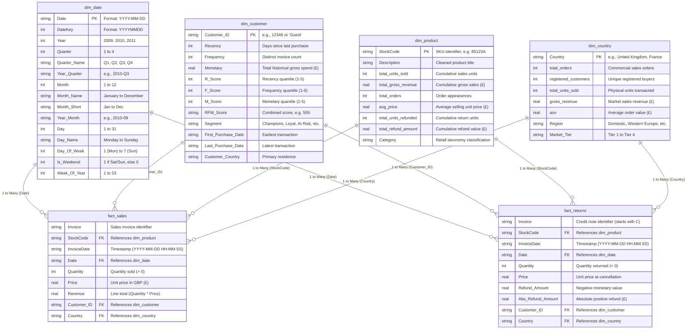

# Power BI Enterprise Star Schema Architecture

**Project:** E-commerce Sales Analysis and Business Intelligence Dashboard  
**Dataset:** UCI Online Retail II  
**Database:** `data/processed/ecommerce_analytics.db`  
**Power BI Directory:** `data/processed/powerbi/`  
**Date:** 2026-11-05  

---

## 1. Architectural Overview & Design Philosophy

The Power BI data model follows **Kimball Dimensional Modeling** best practices to create an enterprise-grade **Star Schema**. 

In analytical reporting, a pure Star Schema is superior to denormalized flat files or heavily normalized Snowflake schemas because:
1. **DAX Simplicity & Performance:** Slicers and filter contexts travel seamlessly across 1-to-many (`1:*`) single-direction relationships without requiring expensive bidirectional filters or complex DAX table expansions (`CROSSFILTER`, `USERELATIONSHIP`).
2. **Shared Conforming Dimensions:** Both `fact_sales` and `fact_returns` share identical dimensional grain across Time (`dim_date`), Customer (`dim_customer`), Product (`dim_product`), and Geography (`dim_country`), enabling synchronized slicing and net margin calculations.
3. **Zero-Orphan Key Guarantee:** All dimension tables encompass the complete universe of keys across both sales and returns, including guest transactions (`Customer_ID = 'Guest'`) and return-only customers.

---

## 2. Entity-Relationship Diagram (ERD)

---

## 3. Relationship Specifications

| From Table (Dimension) | Primary Key | To Table (Fact) | Foreign Key | Cardinality | Filter Direction | Enforce Referential Integrity |
| :--- | :--- | :--- | :--- | :--- | :--- | :--- |
| `dim_date` | `Date` | `fact_sales` | `Date` | 1-to-Many (`1:*`) | Single (`dim_date` $\rightarrow$ `fact_sales`) | Yes (0 orphan keys) |
| `dim_date` | `Date` | `fact_returns` | `Date` | 1-to-Many (`1:*`) | Single (`dim_date` $\rightarrow$ `fact_returns`) | Yes (0 orphan keys) |
| `dim_customer` | `Customer_ID` | `fact_sales` | `Customer_ID` | 1-to-Many (`1:*`) | Single (`dim_customer` $\rightarrow$ `fact_sales`) | Yes (0 orphan keys) |
| `dim_customer` | `Customer_ID` | `fact_returns` | `Customer_ID` | 1-to-Many (`1:*`) | Single (`dim_customer` $\rightarrow$ `fact_returns`) | Yes (0 orphan keys) |
| `dim_product` | `StockCode` | `fact_sales` | `StockCode` | 1-to-Many (`1:*`) | Single (`dim_product` $\rightarrow$ `fact_sales`) | Yes (0 orphan keys) |
| `dim_product` | `StockCode` | `fact_returns` | `StockCode` | 1-to-Many (`1:*`) | Single (`dim_product` $\rightarrow$ `fact_returns`) | Yes (0 orphan keys) |
| `dim_country` | `Country` | `fact_sales` | `Country` | 1-to-Many (`1:*`) | Single (`dim_country` $\rightarrow$ `fact_sales`) | Yes (0 orphan keys) |
| `dim_country` | `Country` | `fact_returns` | `Country` | 1-to-Many (`1:*`) | Single (`dim_country` $\rightarrow$ `fact_returns`) | Yes (0 orphan keys) |

> [!IMPORTANT]
> **No Bidirectional Relationships:** All relationships are strictly configured with **Single** filter direction. Bidirectional filtering causes filter context ambiguity and degrades VertiPaq engine performance in large datasets. Slicing across facts is mediated via the shared dimensions.

---

## 4. Table Schema & Grain Definitions

### 4.1 Fact Tables

#### `fact_sales`
- **Business Grain:** One record per individual product line item on a valid commercial sales invoice.
- **Row Count:** 1,007,983 records.
- **Total Revenue:** £20,476,260.45.
- **Optimization:** Redundant temporal attributes (`Year`, `Month`, `Quarter`, etc.) have been removed. Slicing occurs via `dim_date`.

#### `fact_returns`
- **Business Grain:** One record per individual product line item on a cancellation / credit note transaction.
- **Row Count:** 19,104 records.
- **Total Refund Value:** -£1,462,050.61 (Absolute: £1,462,050.61).
- **Optimization:** Provides both negative `Refund_Amount` for net financial calculations and positive `Abs_Refund_Amount` for direct visual display.

---

### 4.2 Dimension Tables

#### `dim_date` (Date Dimension)
- **Business Grain:** One record per calendar day spanning from `2009-12-01` to `2011-12-31`.
- **Row Count:** 761 calendar days.
- **Key Features:** Marked as an official Date Table in Power BI. Contains standard chronological sort attributes (e.g., `Month_Name` sorted by `Month`, `Year_Month` sorted by `DateKey`).

#### `dim_customer` (Customer Dimension)
- **Business Grain:** One record per unique customer entity.
- **Row Count:** 5,943 records.
  - 5,881 active commercial purchasing customers (with full RFM quantiles and segment labels).
  - 61 refund-only customers (assigned `Segment = 'Cancellation / Refund Only'`).
  - 1 designated `Guest` customer record (handling guest checkout transactions where `Customer_ID` is null).

#### `dim_product` (Product Dimension)
- **Business Grain:** One record per unique product StockCode transacted across both sales and returns.
- **Row Count:** 4,932 SKUs.
  - 4,917 SKUs transacted in regular sales.
  - 15 return-only SKUs (ensures 100% referential integrity for return line items).
- **Classification Taxonomy:** Products are classified into 8 retail merchandise categories:
  - *Home Decor & Lighting* (1,172 SKUs)
  - *Kitchen & Tableware* (508 SKUs)
  - *Bags & Organization* (353 SKUs)
  - *Stationery & Gift Wrap* (370 SKUs)
  - *Holiday & Seasonal* (214 SKUs)
  - *Toys & Children* (96 SKUs)
  - *Service / Fee / Postage* (8 SKUs)
  - *General Gifts & Novelties* (2,211 SKUs)

#### `dim_country` (Geographic Dimension)
- **Business Grain:** One record per sovereign market/nation transacted.
- **Row Count:** 43 countries.
- **Attributes:** Includes regional clustering (`Domestic (UK)`, `Western Europe`, `Developed Export Markets`, `Rest of World`) and commercial revenue tiers (`Tier 1` to `Tier 4`).

